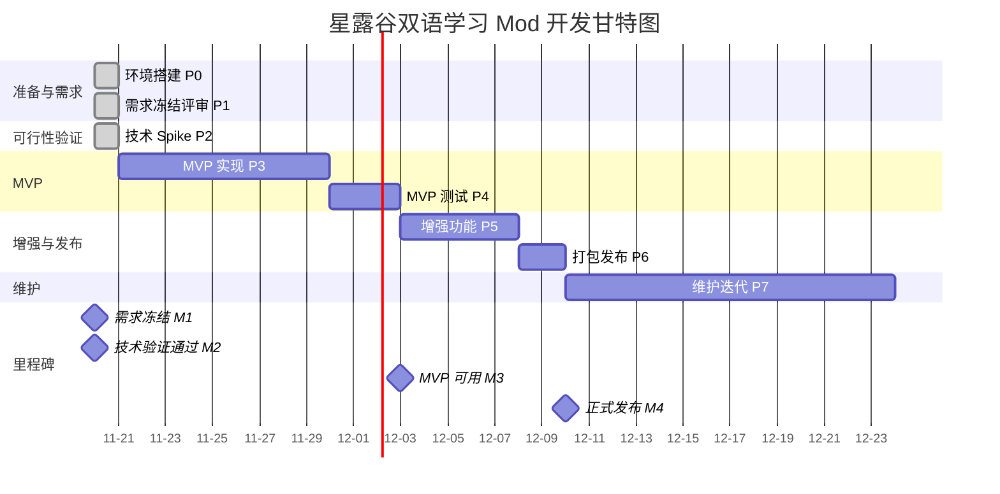
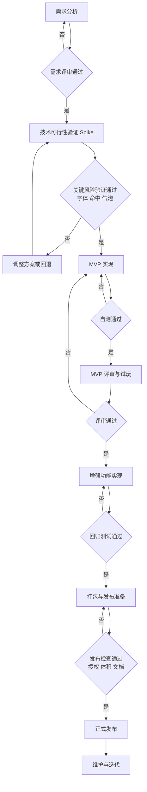

# 星露谷双语学习 Mod · 开发计划与节点控制

> 版本：v0.5 · 更新日期：2026-11-22
> 前提：单人/小团队、需求已基本确认（见《需求规格说明》《资源需求》）
> 当前进度：**P0~P6 全部完成**（2026-11-20 ~ 2026-11-22）；MVP 已可玩，方案 A（物品知识卡片）已完成；发布版本号 **0.5.0**，待发布

---

## 1. 开发方法论

采用 **「阶段门 Stage-Gate」+ 迭代增量（MVP 优先）** 的轻量流程：

- **Spike 先行**：本项目有 3 个技术不确定性（中文字体渲染、对话单词命中、可交互气泡），必须先在可行性验证阶段逐个击破，再进入正式实现，避免返工。
- **MVP 优先**：先交付「仅 NPC 对话 + 查词 + 星标 + 生词本 + 导出」，跑通后再做增强，防止范围蔓延。
- **阶段门控制**：每个阶段结束设一个评审门（Gate），满足出口准则才放行到下一阶段。

---

## 2. 工作分解结构（WBS）

| 阶段 | 任务 | 交付物 | 状态 / 预估（单人） |
|---|---|---|---|
| P0 环境搭建 | 装 SMAPI + .NET SDK、建项目模板、跑通空 mod | 可加载的空 mod + 日志 | ✅ 完成（2026-11-20，实际 1 天） |
| P1 需求冻结 | 补完并评审需求/资源文档 | 冻结版需求、资源文档 | ✅ 完成（2026-11-20） |
| P2 技术 Spike | S1 中文字体渲染；S2 对话单词命中；S3 九宫格气泡+铱星星标；S4 词典加载查词 | 4 个可运行原型 | ✅ 完成（2026-11-20）：S1~S4 全部实机验证通过 |
| P3 MVP 实现 | 整合 Spike → 正式结构（Harmony 补丁、命中、气泡、星标、生词本、语言校验、名称过滤） | 可玩 MVP | ✅ 完成 |
| P4 MVP 测试 | 自测、多存档、多 UI 缩放、性能冒烟 | 测试报告 + 修复 | ✅ 完成（随开发同步验证） |
| P5 增强功能 | GMCM 配置、导出 CSV/MD/Anki、气泡双风格、快捷键（等级过滤曾实现后移除） | 增强版 | ✅ 完成 |
| P6 打包发布 | 字体子集化（15.6MB→2.08MB）、词典构建（5.26万词）、README、Nexus 文案、AI 声明 | 发布包 | ✅ 完成 |
| P7 维护迭代 | 跟进游戏/SMAPI 更新、修 bug、扩展文本面 | 持续 | 长期 |

---

## 3. 甘特图

> 单人估算；起始日已按 P0/P1 实际完成日期 2026-11-20 校准；关键路径 = P2 → P3 → P4（字体与命中检测是瓶颈）。

**时间结论**：P0/P1/P2 已提前于 2026-11-20 全部完成（P2 实际 1 天 vs 预估 3~5 天），后续阶段相应前移；从启动到 **MVP 可用约 2 周**、到**正式发布约 3 周**（单人估算）。

---

## 4. 流程控制图

---

## 5. 里程碑与节点控制表

| 节点 | 里程碑 | 关键交付物 | 出口准则（必须满足才放行） | 主要风险/卡点 |
|---|---|---|---|---|
| **M1** | 需求冻结 ✅已达成 | 冻结版《需求规格说明》《资源需求》 | 所有 F/R 项状态明确、待确认项清零、MVP 范围无歧义 | 需求遗漏、范围蔓延 |
| **M2** | 技术验证通过 ✅已达成 | 4 个 Spike 原型 | ①中文字体渲染清晰 ②对话单词命中准确且打字机门槛生效 ③九宫格气泡+铱星星标可交互 ④查词无卡顿 | 字体渲染失败、命中偏差、性能 |
| **M3** | MVP 可用 ✅已达成 | 可玩 MVP（查词/星标/生词本/导出） | 无崩溃、核心路径走通、多存档与多 UI 缩放通过 | Harmony 补丁随游戏版本失效 |
| **M4** | 正式发布（版本 0.5.0） | 打包 zip、README、Nexus 文案、AI 声明 | 体积达标（2.08MB 字体）、词典可复现、文档齐全 | 授权遗漏、体积超标 |

---

## 6. 迭代节奏与风险控制建议

- **节奏**：以 1 周为迭代，每周末产出一个可运行版本 + 一次评审；M3（MVP 可用）之前**不展开增强功能**，防止范围蔓延。
- **Spike 的 4 个实验按依赖排序**：S2（命中检测）与 S3（气泡/星标）是核心，优先做；S1（字体）与 S4（词典）相对独立可并行。
- **每个门只放行“满足出口准则”的项**：M2 任一 Spike 不通过，就在该节点回退调整方案，不带着风险进入 MVP 实现。
- **版本锁定**：开发期内锁定 Stardew 1.6.x + SMAPI 4.x 目标版本，进入 P7 维护后再按需跟进新版本。

---

## 7. 遗留待办

| 项 | 说明 | 状态 |
|---|---|---|
| 选项文字查词 | 问题对话框的选项（Yes/No 等可点击项）也可悬停查词；选项布局与提示文本不同，需单独处理 | 待定 |
| 释义文本颜色 | 气泡中文释义白色过浅、对比度低 | ✅ 已完成（双风格，文字统一深棕 86,22,12） |
| 释义收敛 | ECDICT 释义偏全偏长 | ✅ 已完成（词典 v2 收敛到 1~2 义项） |
| 词典 -s 变形歧义 | 三单/复数不区分，展示原型合并义项 | 已按方案处理（展示合并义项） |

---

## 8. 后续扩展：悬浮查词覆盖全部文本面

> 现状：查词只覆盖 `DialogueBox`（NPC 对话 / 纯文本对话框 / 问题提示）。本节评估扩展到其它文本面的难度与对象清单。

### 8.1 技术路线（已用 Mono.Cecil 核实）

游戏文本只有两个底层绘制入口，**按 API 分布如下（1.6.15 全程序集扫描）**：

| 入口 | 调用规模 | 现状 |
|---|---|---|
| `SpriteText.drawString` | 59 处调用 / 30 个类型；`drawStringWithScrollCenteredAt`、`...WithScrollBackground` 内部都转调它（`references/decompiled/SpriteText.cs:453/478/483`） | 仅 `DialogueBox` 场景手动复刻布局 |
| `SpriteBatch.DrawString` | 全游戏只用 **4 个重载**：4参 string 94 处、9参 string 82 处、4参 StringBuilder 12 处、9参 StringBuilder 5 处 | 已 hook 前 3 个（卡片用），缺第 4 个 |
| `Utility.drawTextWithShadow`（包装） | 34 个调用方 | 顺带覆盖，无需单独 hook |

- **路线 A（采纳）**：两个入口各挂后置补丁 → 每帧「文本 + 屏幕矩形」注册表 → 统一悬停命中。
- **路线 B（否决）**：逐菜单适配，工作随菜单数线性增长。
- **实测校正**：HUD toast 走 `Utility.drawTextWithShadow`（SpriteFont）；电视文字来自 `Game1.drawObjectDialogue` → **DialogueBox（已覆盖）**；事件主对白同样是 DialogueBox，只有 `Event.drawAfterMap` 横幅是 SpriteText。

### 8.2 文本面清单（按实测入口归类）

| 文本面 | 实际入口 | 坐标 | 现状 | 价值 | 风险 |
|---|---|---|---|---|---|
| NPC 对话 / 问题 / 电视 / 事件主对白 | `DialogueBox` + `SpriteText.drawString` | 屏幕 | ✅ 已实现 | 高 | 低 |
| 物品 tooltip | `IClickableMenu.drawHoverText` → `SpriteBatch.DrawString` | 屏幕 | ✅ F1 知识卡片 | 高 | 低 |
| **信件 / 秘密纸条 / 日志残页** | `LetterViewerMenu.draw`（`drawString`×2 + 居中×2 + `drawTextWithShadow`×1） | 屏幕 | ❌ | **最高**（长文本） | 低 |
| **任务日志** | `QuestLog.draw`（`drawString`×3 + 居中 + 滚动 + `drawTextWithShadow`×4） | 屏幕 | ❌ | **高** | 中（混合 + 滚动 + 点击追踪） |
| **特殊订单板** | `SpecialOrdersBoard.draw`（`drawStringWithScrollCenteredAt` + `drawTextWithShadow`×9） | 屏幕 | ❌ | 高 | 中 |
| 商店 / 木匠 / 日历 / 发货箱 / 建造 / ItemList | 菜单内 `SpriteText.drawString` 片段 + `drawWithShadow` | 屏幕 | ❌ | 中 | 中 |
| JunimoNote 收集包 / 精通追踪 | 混合（SpriteText + `DrawString`） | 屏幕 | ❌ | 中 | 中 |
| **NPC 头顶气泡** | `NPC.drawAboveAlwaysFrontLayer` → `drawStringWithScrollCenteredAt` | **世界** | ❌ | 中 | 高（相机 + 滚动对齐） |
| 节日 / 矿洞 / 火山 / Club 横幅 | `*.drawAboveAlwaysFrontLayer` 滚动文字 | **世界** | ❌ | 低 | 高 |
| HUD toast | `Utility.drawTextWithShadow`（SpriteFont） | 屏幕 | ❌ | 低 | 低 |
| 制作人员名单 / 小游戏 | `TextCreditsBlock`、`CalicoJack`/`Slots`/`Darts` | 屏幕 | ❌ | 无 | 低 |

> 关键：`QuestLog`、`ShopMenu`、`JunimoNoteMenu`、`LetterViewerMenu` **同一菜单同时使用两种 API**，因此不能按 API 切阶段，只能按「文本面」切。

### 8.3 核心难点

1. **滚动/裁剪参数藏在 `drawString` 内部**：`drawBGScroll`、`scroll_text_alignment`、`width=-1` 会在方法内改写实际 `position.X/width`（`SpriteText.cs:502-617`），后置补丁只能拿到入参 → 第一版只处理 `drawBGScroll == -1`（信件/日志等菜单文本），滚动气泡留到世界层阶段。
2. **重复绘制**：`drawTextWithShadow` 会把同文本画两次（阴影+正文），需按「文本 + 位置容差」去重。
3. **坐标空间**：菜单=屏幕坐标；头顶气泡/招牌=世界坐标，需相机换算。
4. **悬停语义冲突**：菜单里鼠标多停在物品/按钮上，需白名单 + 优先级，避免误触。
5. **每帧重建**：矩形只在当帧有效；本帧捕获、下一帧命中，需双缓冲。

### 8.4 建议实施顺序（2026-11-23 修订，按「价值 × 风险」）

| 阶段 | 范围 | 状态 |
|---|---|---|
| 0 | 统一捕获基础设施：`SpriteText.drawString` + 4 个 `DrawString` 重载 hook、每帧双缓冲去重、共享词布局、GMCM 开关（默认关）、`F10` 矩形调试 | ✅ 2026-11-23 实机验证 |
| 1 | 信件 / 秘密纸条 / 日志残页（`LetterViewerMenu`，纯屏幕坐标） | ✅ 2026-11-23 实机验证（翻页残留用「每帧校验原词」通用修复） |
| 2 | 任务日志（`QuestLog`，混合 API + 预换行 + 裁剪滚动） | ✅ 2026-11-23 实机验证；对齐问题已修（前缀测量 / 阴影去重 / `^` 换行 / 换行原点） |
| 3a | 特殊订单板（`SpecialOrdersBoard`，纯白名单接入；多行/缩字复用现有管线） | ✅ 2026-11-23 实机验证（`stage-3a.md`） |
| 3b-1 | 木匠/建造菜单（`CarpenterMenu`，纯白名单接入；多行描述/配料名复用管线） | ✅ 2026-11-23 实机验证（`stage-3b-1.md`） |
| 3b-2 | 小镇任务板 `Billboard`（任务描述多行；日历为同类型另一分支） | ✅ 2026-11-24 实机验证（`stage-3b-2.md`） |
| 3b-3 | `ShippingMenu`（发货箱日终）+ `ItemListMenu` | ✅ 2026-11-24 实机验证（`stage-3b-3.md`） |
| 3b-4 | `ShopMenu`（正文；tooltip 不接管，走 F1 卡片；含点击吞掉） | ✅ 2026-11-24 实机验证（`stage-3b-4.md`） |
| 3c | JunimoNote / 精通追踪 | 待做 |
| 4 | 世界层：NPC 头顶气泡 + 各 `drawAboveAlwaysFrontLayer` 横幅（相机换算） | 待做 |
| 5a | 扩展面统一点击吞掉（8 菜单 12 处 override；气泡∪词∪桥接内吞左右键） | ✅ 2026-11-24 实机验证（`stage-5a.md`） |
| 5b | 扩展面星标收藏（气泡内星标 + 收藏/取消 + 写盘） | ✅ 2026-11-24 实机验证（`stage-5b.md`） |
| — | 不做：HUD toast（低价值）、电视（已覆盖）、制作名单、小游戏 | — |

> **验证方法（F10）**：开 `Extended lookup=On` 后按 `F10` 显示词矩形并把捕获数据写入 SMAPI 日志（`[诊断]`）。该键是开发对位工具，不进 GMCM、默认关闭、关闭时零捕获开销；用意见 `README.md`「测试键 F10 的用意」。

> 历史：曾按「阶段2 SpriteText → 阶段3 SpriteFont」推进（分支 `backup/other-agent-807c988`，+1175/−231），因按 API 切分导致同一菜单重复实现、并整体重写 `WordOverlay` 而回滚。本轮改为按文本面切片，`WordOverlay`/`KnowledgeCardMenu` 保持原路径。

### 8.5 不做项

- 烤进贴图的文字（无法提取）。
- 全量 WSD/上下文消歧（超出查词范畴）。
- 制作人员名单与小游戏内文字（非学习场景）。

---

## 9. 版本记录（Git Tag）

| Tag | 日期 | 内容 |
|---|---|---|
| `v0.5.0` | 2026-11-22 | 首个可发布版本：P0~P6 全部完成 + 方案 A（物品知识卡片）；含对话查词、生词本、导出、GMCM、双气泡风格、5.26 万词词典、2.08MB 字体子集 |

> **发布包状态（2026-11-23）**：`dist/BilingualLearning 0.5.0.zip` 仍是改造前构建，manifest 内 `MinimumGameVersion=1.6.0`、`UpdateKeys=[]`。源码已收紧到 `1.6.15` 并填 `Nexus:55803`，**发布前必须重新打包**（`dotnet build` 会同时生成 zip，再覆盖到 `dist/`）；本轮按约束未动 `dist/`。

### 发布前检查清单

- [x] 版本号 0.5.0（manifest + csproj 一致）
- [x] 作者 MarenQi / UniqueID MarenQi.BilingualLearning
- [x] 发布包 `dist/BilingualLearning 0.5.0.zip`（标准结构）
- [x] README + Nexus 文案 + AI 使用声明 + CHANGELOG
- [x] 字体子集化 + 词典可复现（add_inflections.py / subset_font.py）
- [x] `UpdateKeys` 填 Nexus ID（`Nexus:55803`）；GitHub 仓库地址待建后补
- [x] `MinimumGameVersion` 收紧到实测 `1.6.15`（源码已改）
- [ ] **重新打包发布包**（源码 manifest 已变更，现有 dist zip 与源码不一致）
- [ ] Nexus Tag 勾选 `AI Assisted`
- [ ] Nexus 上传截图 + Logo（可选）

