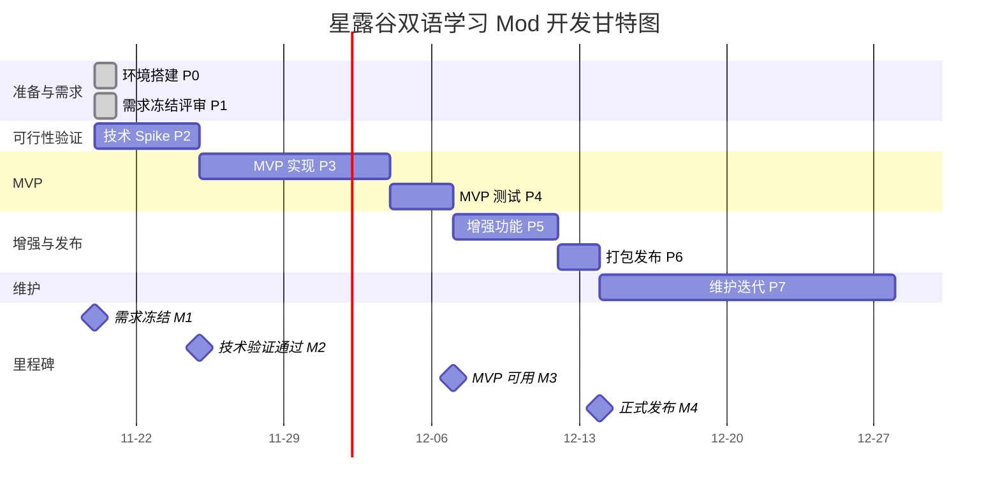
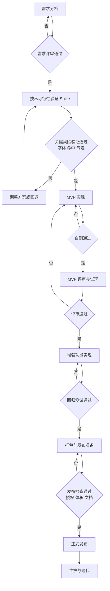

# 星露谷双语学习 Mod · 开发计划与节点控制

> 版本：v0.2 · 更新日期：2026-11-20
> 前提：单人/小团队、需求已基本确认（见《需求规格说明》《资源需求》）
> 当前进度：**P0 环境搭建 ✅、M1 需求冻结 ✅（均 2026-11-20 完成）**；**P2 技术 Spike 进行中**——S2 对话单词命中 ✅、S3 九宫格气泡+铱星星标 ✅（已实现并构建通过，待实机验证），S1 中文字体 / S4 词典 待做

---

## 1. 开发方法论

采用 **「阶段门 Stage-Gate」+ 迭代增量（MVP 优先）** 的轻量流程：

- **Spike 先行**：本项目有 3 个技术不确定性（中文字体渲染、对话单词命中、可交互气泡），必须先在可行性验证阶段逐个击破，再进入正式实现，避免返工。
- **MVP 优先**：先交付「仅 NPC 对话 + 查词 + 星标 + 生词本 + 导出」，跑通后再做增强，防止范围蔓延。
- **阶段门控制**：每个阶段结束设一个评审门（Gate），满足出口准则才放行到下一阶段。

---

## 2. 工作分解结构（WBS）

| 阶段 | 任务 | 交付物 | 状态 / 预估（单人） |
|---|---|---|---|
| P0 环境搭建 | 装 SMAPI + .NET SDK、建项目模板、跑通空 mod | 可加载的空 mod + 日志 | ✅ 完成（2026-11-20，实际 1 天） |
| P1 需求冻结 | 补完并评审需求/资源文档 | 冻结版需求、资源文档 | ✅ 完成（2026-11-20） |
| P2 技术 Spike | S1 中文字体渲染；S2 对话单词命中；S3 九宫格气泡+铱星星标；S4 词典加载查词 | 4 个可运行原型 | 🔄 进行中：S2 ✅ / S3 ✅（构建通过，待实机验证）；S1 / S4 待做 |
| P3 MVP 实现 | 整合 Spike → 正式结构（Harmony 补丁、命中、气泡、星标、生词本、语言校验） | 可玩 MVP | 5~8 天 |
| P4 MVP 测试 | 自测、多存档、多 UI 缩放、性能冒烟 | 测试报告 + 修复 | 2~3 天 |
| P5 增强功能 | GMCM 配置、导出 CSV/MD/Anki、等级过滤、快捷键、i18n | 增强版 | 3~5 天 |
| P6 打包发布 | 字体子集化+改名、词典构建、授权文件、README、Nexus 素材 | 发布包 | 1~2 天 |
| P7 维护迭代 | 跟进游戏/SMAPI 更新、修 bug、扩展文本面 | 持续 | 长期 |

---

## 3. 甘特图

> 单人估算；起始日已按 P0/P1 实际完成日期 2026-11-20 校准；关键路径 = P2 → P3 → P4（字体与命中检测是瓶颈）。

**时间结论**：P0/P1 已提前于 2026-11-20 完成，后续阶段相应前移；从启动到 **MVP 可用约 3 周**、到**正式发布约 4 周**（单人估算；若并行或已有 SMAPI 经验可压缩）。

---

## 4. 流程控制图

---

## 5. 里程碑与节点控制表

| 节点 | 里程碑 | 关键交付物 | 出口准则（必须满足才放行） | 主要风险/卡点 |
|---|---|---|---|---|
| **M1** | 需求冻结 ✅已达成 | 冻结版《需求规格说明》《资源需求》 | 所有 F/R 项状态明确、待确认项清零、MVP 范围无歧义 | 需求遗漏、范围蔓延 |
| **M2** | 技术验证通过（下一步） | 4 个 Spike 原型 | ①中文字体渲染清晰 ②对话单词命中准确且打字机门槛生效 ③九宫格气泡+铱星星标可交互 ④查词无卡顿 | 字体渲染失败、命中偏差、性能 |
| **M3** | MVP 可用 | 可玩 MVP（查词/星标/生词本/导出） | 无崩溃、核心路径走通、多存档与多 UI 缩放通过 | Harmony 补丁随游戏版本失效 |
| **M4** | 正式发布 | 打包 zip、README、授权文件、Nexus 素材 | 体积达标、字体子集化已改名+附 OFL、词典构建可复现、文档齐全 | 授权遗漏、体积超标 |

---

## 6. 迭代节奏与风险控制建议

- **节奏**：以 1 周为迭代，每周末产出一个可运行版本 + 一次评审；M3（MVP 可用）之前**不展开增强功能**，防止范围蔓延。
- **Spike 的 4 个实验按依赖排序**：S2（命中检测）与 S3（气泡/星标）是核心，优先做；S1（字体）与 S4（词典）相对独立可并行。
- **每个门只放行“满足出口准则”的项**：M2 任一 Spike 不通过，就在该节点回退调整方案，不带着风险进入 MVP 实现。
- **版本锁定**：开发期内锁定 Stardew 1.6.x + SMAPI 4.x 目标版本，进入 P7 维护后再按需跟进新版本。
